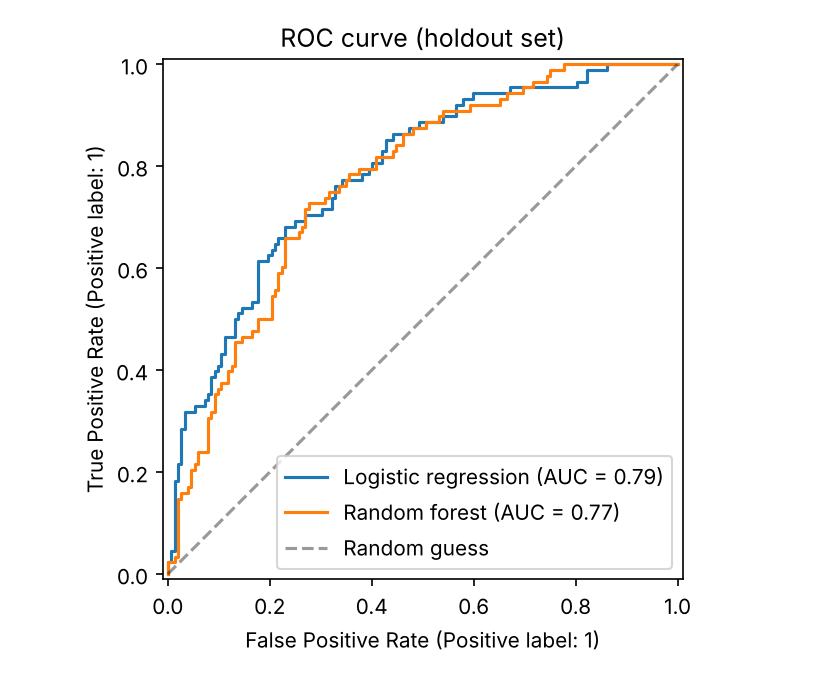
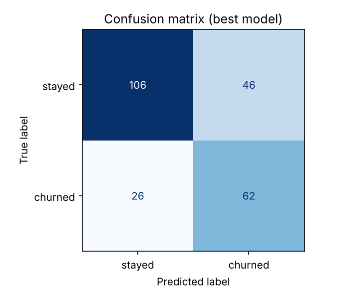
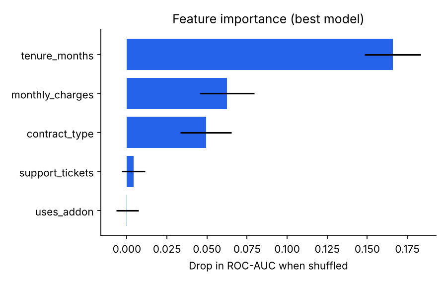

# ML Intern Portfolio: Customer Churn Classification

[](https://github.com/Manishjangir01/ml-intern-portfolio/actions/workflows/tests.yml)


A small end-to-end machine learning project: generate a tabular customer dataset, compare a logistic regression baseline with a random forest, save the better model, and evaluate it with a confusion matrix, ROC curve and feature importance.

> **Note on the data:** the dataset is **synthetic** (generated in `src/ml_intern/data.py`), so the scores below show that the pipeline works. They are not evidence of how this model would perform on real customers.

## Results

Holdout set of 240 rows (20% stratified split), churn rate 36.5%:

| Model | Accuracy | Precision | Recall | F1 | ROC-AUC | 5-fold CV ROC-AUC |
|-------|---------:|----------:|-------:|---:|--------:|------------------:|
| **Logistic regression** (selected) | 0.700 | 0.574 | 0.705 | 0.633 | **0.788** | 0.799 ± 0.022 |
| Random forest | 0.721 | 0.602 | 0.705 | 0.649 | 0.771 | 0.771 ± 0.025 |

The two models are close. The gap in ROC-AUC is about the size of the fold-to-fold spread, so the choice of logistic regression is only weakly supported. A simple, explainable model is a reasonable default here.

<p>
  
  
  
</p>

How to read it:

- The model finds about 70% of the customers who actually churn (recall 0.705).
- About 4 in 10 customers it flags would have stayed anyway (precision 0.574), so a retention campaign based on it would contact some customers unnecessarily.
- Tenure matters most, then monthly charges and contract type. This matches how the data was generated, so it is a sanity check rather than a discovery.

## What the model does

- **Target:** `churned` (1 = customer left)
- **Features:** tenure, monthly charges, support tickets, contract type, add-on usage
- **Baseline:** logistic regression with class weights
- **Candidate:** random forest (200 trees, depth 8)
- **Selection:** higher ROC-AUC on the stratified holdout set. Cross-validation is reported as extra context because 240 rows is a small test set.
- **Preprocessing:** scaling for numeric columns and one-hot encoding for contract type, inside a scikit-learn `Pipeline` (unseen categories are ignored instead of crashing)

## Project layout

```
src/ml_intern/
    data.py        # synthetic dataset generator and loader
    features.py    # preprocessing pipeline
    train.py       # train, compare, cross-validate and save the best model
    evaluate.py    # accuracy, precision, recall, F1, ROC-AUC
    report.py      # ROC curve, confusion matrix, feature importance charts
notebooks/01_eda.ipynb   # EDA and evaluation walkthrough (outputs saved)
tests/                   # 9 tests, run on every push
reports/                 # metrics.json and figures/
```

## Setup

Python 3.10 or newer.

```bash
python -m venv .venv
source .venv/bin/activate          # Windows PowerShell: .venv\Scripts\Activate.ps1
pip install -e ".[dev]"
```

## Run

```bash
python -m ml_intern.train      # writes data/raw/churn.csv, models/churn_model.joblib, reports/metrics.json
python -m ml_intern.report     # writes the charts in reports/figures/
pytest                         # run the tests
jupyter notebook notebooks/01_eda.ipynb
```

To use your own data, put a CSV with the same column names at `data/raw/churn.csv`, or change `FEATURE_COLUMNS` in `src/ml_intern/data.py`.

## Ideas for next steps

- Try gradient boosting and tune hyperparameters with cross-validation
- Choose the decision threshold using the cost of a missed churner vs a wasted offer
- Replace the synthetic data with a public churn dataset and compare the results

## License

MIT, see [LICENSE](LICENSE).
